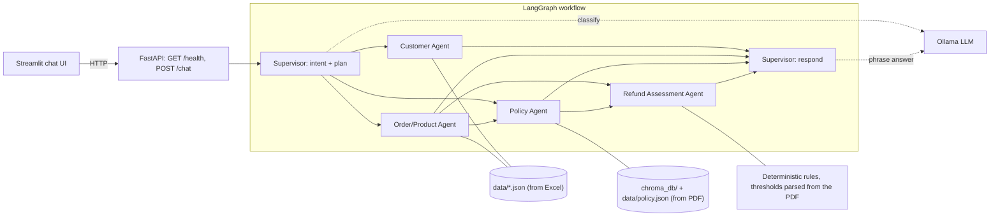

# ABC Retail Customer Support Assistant

A local-first, multi-agent chatbot that answers questions from an Excel workbook (Customers, Orders, Products)
and a refund-policy PDF. Python does the exact lookups, joins and refund rules; a local LLM (Ollama)
interprets the question and phrases the answer. No paid API keys.

**Conversation memory.** The conversation (messages) and a structured memory of what the user is talking about live in
the LangGraph state and are saved by a LangGraph **checkpointer** (SQLite) per session ID, so follow-ups such as
"What about the product?", "Who ordered it?", "What about O003?", "the second one" or "Why?" are resolved against earlier
turns, and conversations survive a backend restart. See [Conversation memory](#conversation-memory).

**Static data store.** The Excel and PDF are converted *once* by `python ingest.py` into files that live in this
repo: the Excel sheets become `data/customers.json`, `orders.json`, `products.json`; the PDF becomes
`data/policy.json` (sections, page numbers, refund thresholds) plus embeddings persisted in `chroma_db/`.
At runtime the agents only read that store. The source Excel/PDF are not needed to run the app, and nothing is re-parsed per run.

## Architecture



Edges show the possible paths; a conditional `route_next` after every node picks only the planned next agent.

**Workflow.** The Supervisor extracts IDs with regex (the LLM can never invent one), classifies intent, and builds a
plan. Only the planned specialists run, always in the order customer → order/product → policy → refund:

| Question type | Agents that run |
|---|---|
| Customer profile | Customer |
| Orders / product details | Order/Product |
| Policy question | Policy |
| Refund eligibility | Order/Product → Policy → Refund Assessment |
| "Why?" / "explain" after an answer | none: facts are restored from memory |
| Anything else | none (help text) |

The Refund Assessment Agent is plain Python (`assess_refund` in `services.py`). It reads its thresholds (30 days,
7 days, $2,000) **from the policy text itself**, and returns `eligible`, `ineligible`, `insufficient_evidence` or
`requires_clarification`. It never returns `eligible` unless every check the data *can* verify passes, and it lists
what the data cannot verify. The LLM only writes prose around the verdict; the verdict header is added by code.

**Decisions worth knowing about**
- *Order date stands in for delivery date.* The workbook has no delivery column. Policy §8 rejects orders older
  than 30 days outright, so that rule is applied to the order date; inside the window the answer says the delivery date is unknown.
- *Sample amounts are inconsistent* (e.g. O005: 3 × 100 ≠ 600). This is reported as a data-quality note, never silently "fixed".
- *No membership field exists*, so "is C001 premium?" gets an honest "can't verify".
- *PII*: email and phone are masked in answers (`MASK_PII=false` to disable). PDF text is capped, wrapped in
  `<policy_text>` tags for the LLM, and treated as untrusted; business rules never come from model output.
- *Ambiguity*: two different order IDs in one question, a missing ID, or an unknown ID produce a clarification or
  "not found", not a guess. Follow-ups like "is it eligible?" reuse IDs from earlier user turns.
- *Graceful degradation*: if Ollama is down, routing falls back to keywords and answers come from templates
  (flagged in `warnings`); an invalid workbook/PDF makes `/health` report `degraded` and `/chat` return 503.

## Layout

```
customer_support/
  ingest.py           one-time: Excel -> data/*.json, PDF -> data/policy.json + chroma_db/
  data/               static store (committed): customers/orders/products.json, policy.json, manifest.json
  chroma_db/          persisted Chroma collection of policy-section embeddings (committed)
  app.py              FastAPI backend (/health, /chat)
  streamlit_app.py    Streamlit chat UI (calls the API over HTTP)
  services.py         DataStore (JSON), PolicyIndex (Chroma/keyword), refund rules, Ollama client
  agents/             supervisor.py, customer.py, order_product.py, policy.py, refund.py,
                      memory.py (follow-up resolution + memory update), graph.py (LangGraph wiring + checkpointer)
  .state/             SQLite checkpoint database (created at runtime, git-ignored)
  tests/              pytest (no LLM or network needed)
  requirements.txt, requirements-embeddings.txt, .env.example
```
The source Excel and PDF stay in the parent folder and are only read by `ingest.py`.

## Conversation memory

Two things are kept in the LangGraph state and persisted by the checkpointer under `thread_id = session_id`:

| State key | Contents |
|---|---|
| `messages` | the user/assistant transcript (reducer appends; capped at the last 40) |
| `memory` | `focus` (customer/order/product in play, including ones derived by joins: order O005 pins customer C005 and product P001), `last_intents`, `options` (choices just listed), `last` / `last_refund` (facts of the previous answer / refund verdict, for "why?") |

Everything else in the state (plan, route, retrieved rows, assessment, answer) is per-turn and reset by `run_chat`.

**How a follow-up is understood** (`agents/memory.py`, called by the Supervisor):

| User says (after discussing O005) | Resolved as |
|---|---|
| "What about the product?" / "What is its price?" | product info for **P001** (the order's product) |
| "Who ordered it?" / "And their orders?" | customer **C005** / C005's orders |
| "Is it eligible?" / "Is that order refundable?" | refund assessment for **O005** |
| "What if it was damaged?" | refund assessment for O005 with a damaged-item claim |
| "What about O003?" / "And Customer 7?" | the **same kind of request** as before, for the new entity |
| "the second one" / "the latest" (after a list of orders) | that order from the options just shown |
| "Why?" | the previous refund verdict is re-explained from saved facts; no agent re-runs |

Design rules:
- **IDs never come from the LLM.** They come from the user's text or from the saved focus. With Ollama running, the model
  only classifies intent, and it is shown the focus and the last turns so it can read elliptical questions.
  Without Ollama, keyword rules do the same job (tests cover both).
- **No guessing.** "What about the product?" in a brand-new conversation asks which product, instead of listing everything
  or picking one. A product-only or policy-only turn does not drop the order focus; a different customer does.
- **Transparency.** Answers that used memory start with *"Using earlier context: product P001"*, and `/chat` returns
  `context.interpreted`, `context.resolved` and `context.focus`.
- **Sessions are isolated** by session ID. The UI keeps the ID in the URL (`?sid=...`), so a refresh restores the
  transcript from `GET /sessions/{id}`; "New conversation" starts a new ID.
- **Checkpointer.** `SqliteSaver` at `.state/checkpoints.sqlite` (`CHECKPOINT_DB` to move it, `:memory:` for none). On a Python
  without LangGraph the built-in runner keeps sessions in memory only. Conversations are not deleted automatically;
  delete the file to reset everything.

## Setup (Windows PowerShell)

Python **3.12 or 3.13** gives the full stack (LangGraph, Chroma, sentence-transformers). From the workspace root,
with your virtual environment active:

```powershell
uv venv --python 3.12 .venv312        # or: py -3.12 -m venv .venv312
.\.venv312\Scripts\Activate.ps1
cd customer_support
uv pip install -r requirements.txt -r requirements-embeddings.txt   # or: pip install ...
Copy-Item .env.example .env        # optional; defaults work
```

> **Python 3.14+** cannot install `chromadb`/`sentence-transformers`/`torch`, and `langgraph` fails to import (no
> `ormsgpack` wheel); `requirements.txt` skips those packages there via environment markers. The app still runs:
> `ingest.py` skips the Chroma build, retrieval uses a built-in keyword ranker over `data/policy.json`, and a built-in runner
> executes the same graph definition with in-memory sessions. `GET /health` shows what is active (`graph_backend`,
> `checkpointer`, `policy.retrieval`).

### Ollama (local LLM)

```powershell
winget install Ollama.Ollama          # or download from https://ollama.com
ollama pull qwen2.5:3b                # ~2 GB; use qwen2.5:7b or llama3.2:3b if you prefer
ollama list                           # confirm the model is present
```
Set `OLLAMA_MODEL` in `.env` to the model you pulled. Ollama runs on `http://127.0.0.1:11434` by default.
The app works without it, with template answers.

### Ingestion (one time)

```powershell
python ingest.py                  # Excel -> data/*.json; PDF -> data/policy.json + chroma_db/
python ingest.py --no-embeddings  # skip Chroma (keyword retrieval)
```
This validates the workbook schema, parses the PDF into sections with page numbers, reads the refund thresholds
(30 days, 7 days, $2,000) from the policy text, embeds each section with `all-MiniLM-L6-v2` (first run downloads
~90 MB) and writes `data/manifest.json` with source-file hashes. The generated `data/` and `chroma_db/` are meant to
be committed. **Re-run it only when the Excel or PDF changes**, then restart the backend. If the store is missing or
invalid, `/health` reports `degraded` with a "run `python ingest.py`" message, and `/chat` returns 503.

## Run

Two terminals, both from `customer_support/` with the venv active:

```powershell
# 1. Backend
uvicorn app:app --port 8000

# 2. UI
streamlit run streamlit_app.py
```
Open http://localhost:8501. API docs are at http://127.0.0.1:8000/docs. Endpoints: `GET /health`,
`POST /chat` (`{"message": "...", "session_id": "optional"}`; the reply includes the `session_id` to reuse),
`GET /sessions/{session_id}` (persisted messages + memory).

**Refund dates.** The sample orders are dated 2026-07-01 to 2026-07-10, so on today's date every order is past
the 30-day window (correctly *ineligible*). To demo an eligible refund, set a reference date before starting the backend:
```powershell
$env:REFERENCE_DATE = "2026-07-20"; uvicorn app:app --port 8000
```

## Example questions

| Try | Expect |
|---|---|
| `Show customer C001` | Profile, masked email/phone, source `Customers` |
| `What orders did C002 place?` | Order list joined to product names |
| `Tell me about product P003` / `What products do you have?` | Product details / list |
| `How long does a refund take?` | §5 passage with page reference |
| `Can a digital product be refunded?` | §2 passage |
| `Who pays for return shipping?` | §4 passage |
| `Does a premium customer receive faster processing?` | §8 passage + note that the workbook has no tier field |
| `Is order O005 eligible for a refund?` | `eligible` (REFERENCE_DATE=2026-07-20) or `ineligible` (today), with checks and caveats |
| `Is order O999 eligible for a refund?` | `insufficient_evidence`: order not found |
| `Is my order eligible for a refund?` | `requires_clarification`: asks for an order ID |

A conversation that uses memory:

| Turn | You ask | Expect |
|---|---|---|
| 1 | `Does Customer 5 is eligible to get a refund?` | Customer 5 has one order, O005, so it is assessed directly |
| 2 | `What about the product?` | Product 1 / P001 details, marked "Using earlier context" |
| 3 | `Who ordered it?` | Customer C005's profile |
| 4 | `Why?` | the refund verdict re-explained with its checks |
| 5 | `What if it was damaged?` | O005 re-assessed with the 7-day damaged-item caveat |
| 6 | `What about O003?` | O003 (same kind of request as turn 5) |

Direct API calls (reuse the returned `session_id`):
```powershell
$r = Invoke-RestMethod http://127.0.0.1:8000/chat -Method Post -ContentType 'application/json' `
  -Body '{"message":"Is order O005 eligible for a refund?"}'
Invoke-RestMethod http://127.0.0.1:8000/chat -Method Post -ContentType 'application/json' `
  -Body (@{message="What about the product?"; session_id=$r.session_id} | ConvertTo-Json)
```

## Tests

```powershell
python -m pytest -q
```
Covers ingest and JSON store loading (including corrupt/missing files and a check that the committed `data/` matches the
source files), policy retrieval, refund rules (including the 30-day boundary,
manager approval, non-delivered/cancelled orders, restricted products, empty policy), agent routing, end-to-end demo
flows, conversation memory (follow-ups, "why?", ordinals, session isolation, SQLite persistence across a simulated restart), LLM-failure fallback, and the HTTP API. No test needs Ollama or network access. One extra test builds and queries a
real Chroma index; it is skipped unless `RUN_EMBEDDING_TESTS=1` (needs the embeddings packages and a model download):
```powershell
$env:RUN_EMBEDDING_TESTS = "1"; python -m pytest -q
```

## Configuration

See `.env.example`: `OLLAMA_HOST`, `OLLAMA_MODEL`, `OLLAMA_TIMEOUT`, `STORE_DIR`, `CHROMA_DIR`, `WORKBOOK_PATH`, `POLICY_PDF_PATH` (ingest only),
`CHECKPOINT_DB`, `USE_EMBEDDINGS` (`auto`/`true`/`false`), `EMBED_MODEL`, `REFERENCE_DATE`, `MASK_PII`, `API_URL`.

## Known limitations

- The Ollama-backed path (LLM intent classification and phrased answers) is implemented but was **not exercised**
  in development: Ollama was not installed. The template/fallback path is what the tests and live checks cover.
- Chroma retrieval and the real LangGraph backend were verified on Python 3.12 (57 tests pass there, including a Chroma round-trip); on 3.15 they fall back as described above.
- Follow-up understanding is rule-based plus an optional LLM intent hint: unusual phrasings with no reference word and no
  running LLM (e.g. "and the thing they bought?") are not understood. It also does not resolve several entities at once or comparisons
  ("compare it with C003").
- Item condition, packaging, proof of purchase and "Final Sale" are not in the data; they are reported as unverified, not assumed.
- Keyword retrieval (fallback only) uses a small synonym table; unusual phrasings may miss. Chroma embeddings handle paraphrases.
- `data/` holds the sample customers' emails/phones in plain JSON (committed). Fine for sample data; do not commit real PII.
